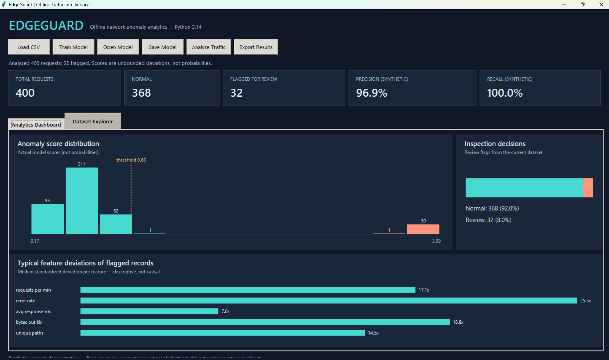
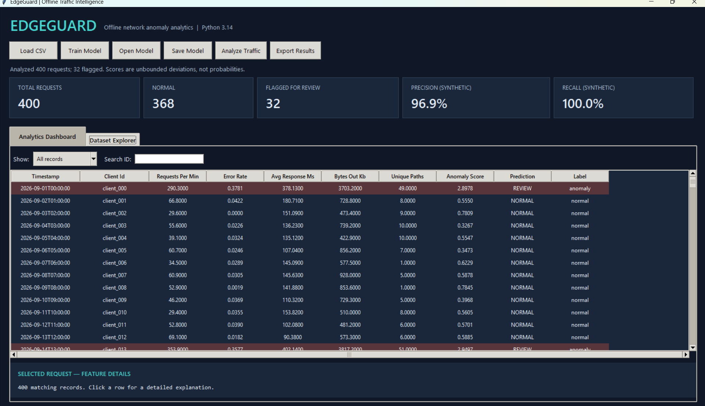
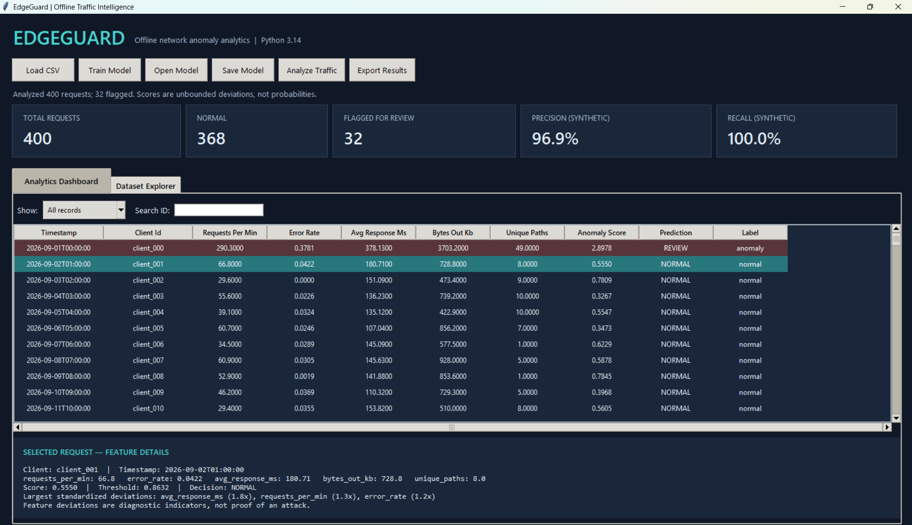

# EdgeGuard Desktop — Offline Traffic Anomaly Workbench

**Standalone Windows desktop application** for investigating unusual web-traffic patterns using an interpretable robust-statistical anomaly model. No browser, FastAPI, localhost, or web server is required. Python 3.14 is supported because this version depends only on the standard library (including Tkinter).

> **Important:** This version deliberately uses a *robust median/MAD anomaly scoring baseline*, **not Isolation Forest**. It avoids NumPy/SciPy binaries blocked by Windows Application Control on some devices. Don't describe this as Isolation Forest in CVs or interviews. Synthetic security data does not demonstrate operational intrusion detection.

## Features

- Dark-themed Tkinter Windows desktop interface with two tabs: Analytics Dashboard and Dataset Explorer. The dashboard has actual-score histogram, decision split, descriptive feature-deviation bars, and summary metrics. The explorer offers horizontal/vertical scrolling, client-ID search, NORMAL/REVIEW filters, row-specific details, and CSV export.
- Load arbitrary CSV datasets containing the required numeric features; built-in synthetic dataset contains **400** records.
- Train a deterministic robust median/MAD anomaly-scoring model with configurable contamination fraction from CLI.
- Save and reload models as human-readable JSON.
- Batch predict **NORMAL** / **REVIEW**, export results to CSV.
- Calculate labeled confusion matrix, precision, recall and false-positive rate when labels exist.
- Repeatable CLI pipeline, standard-library unit tests, GitHub Actions on Python 3.11 and 3.14.

## What to click in the desktop GUI

1. Launch the application; `data/sample.csv` (400 synthetic rows) loads automatically.
2. Click **Train Model**, then **Analyze Traffic**.
3. Under **Analytics Dashboard**, review request counts, score histogram, decision split, feature deviations, precision and recall (when labels exist). The histogram uses raw anomaly scores, not probabilities.
4. Select **Dataset Explorer** to browse every request; filter to flagged/normal, search client IDs, or click a row to see feature values, model threshold, score, decision and largest standardized deviations.
5. Click **Export Results** to save all scored rows as a CSV file.

The bars show descriptive deviations, not verified causal explanations. Precision and recall on the bundled data are in-sample synthetic metrics. The interface does not use or need images.

## Launch on Windows

```powershell
cd D:\edgeguard-desktop-complete
py -3.14 -m edgeguard.desktop
```

Or double-click `RUN_WINDOWS.bat`. If Python is present, **no pip install is necessary**.

## Headless training / evaluation (no server)

```powershell
py -3.14 -m edgeguard.cli train --input data/sample.csv --model outputs/edgeguard.json
py -3.14 -m edgeguard.cli evaluate --input data/sample.csv --model outputs/edgeguard.json --output outputs/metrics.json --csv outputs/inspections.csv
py -3.14 -m unittest discover -s tests -v
```

## CSV schema

Numeric fields: `requests_per_min`, `error_rate` (0–1), `avg_response_ms`, `bytes_out_kb`, `unique_paths`.
Optional: `timestamp`, `client_id`, `label` (`normal` or `anomaly`). Missing numeric values and negative inputs are rejected with row numbers.

## Methodology and limitations

Scores combine log-transformed median absolute deviations with feature weights; the anomaly threshold is calibrated to the training score percentile. The method is unsupervised and intentionally interpretable, but using the training dataset again for evaluation is **in-sample**: it is not a holdout test. Results on synthetic data are not evidence of real-world attack detection. Anomalies are flagged for review, never automatically blocked.

A sound follow-up is to collect privacy-safe non-synthetic or independently generated data, train on one split, and report holdout precision/recall and latency by scenario. Avoid mixing training and test data.

## Repo guide

`edgeguard/core.py` validation, training, scoring, metrics; `edgeguard/desktop.py` Tkinter GUI; `edgeguard/cli.py` CLI; `data/sample.csv` synthetic records; `tests/` unit tests; `docs/ARCHITECTURE.md` design; `.github/workflows/ci.yml` automated tests.

## Application Screenshots

### Analytics Dashboard

The interactive dashboard presents traffic volume, anomaly scores, model predictions, and evaluation metrics from synthetic network traffic.



### Dataset Explorer

The Dataset Explorer allows users to browse traffic records, inspect individual requests, view anomaly scores, and compare model predictions with synthetic ground-truth labels.



### Individual Request Inspection



## Ethical use

All included traffic records are synthetic. This prototype neither intercepts traffic nor sends network requests. It is **not** a web application firewall or validated security product.

MIT License. Third-party software is not redistributed.
